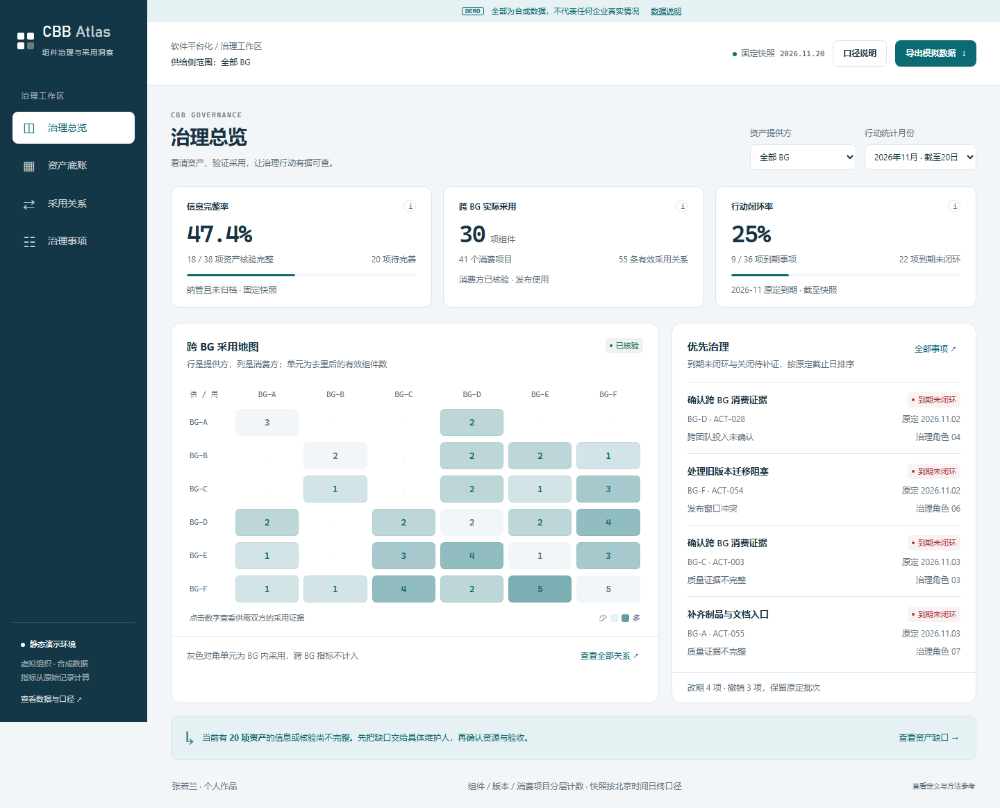

# CBB Atlas · 组件治理与采用洞察

一个以 **资产底账、有效采用、治理闭环** 为主线的静态交互看板。适合展示流程数字化、平台运营、项目治理与指标口径能力。

[打开在线演示](https://capilot-flow.github.io/cbb-governance-dashboard/)



**全部组织、角色、项目、证据编号和数值均为合成数据。没有使用任何企业私有信息，不代表任何公司的实际业绩，也不是生产系统。**

## 能做什么

- 在提供 BG 范围内查看信息完整率、去重后的跨 BG 组件 / 项目采用、原定到期行动闭环率。
- 点击采用矩阵，进入具体供需关系；查看资产版本、Owner、证据及治理事项详情。
- 搜索、状态筛选、排序与分页；筛选状态保留在 URL，可前进后退。
- 导出当前筛选全量 CSV 或完整模拟 JSON，按同一口径复算。
- 无运行时框架、CDN、服务器或登录依赖；支持桌面、平板、手机，包含键盘与 reduced-motion 支持。

## 数据与口径

数据固定快照为 **2026-11-20 日终（北京时间）**。6 个虚拟 BG、42 个登记组件、84 个版本、147 条采用记录和 60 个治理事项，由固定规则与种子标记生成。以 `data/mock.json` 实际记录数为准。

`scripts/generate_mock.py` 是唯一模拟数据生成源，`src/metrics.js` 是统计逻辑唯一来源。详细定义见 [PRODUCT.md](PRODUCT.md)，站内“口径说明”也可直接打开。

月份筛选仅改变行动统计批次；资产和采用始终是固定快照。归档单列，试用不冒充发布采用；关闭状态没有证据不计闭环；改期与撤销保留在原定批次；零分母显示“—”。这些约定可通过测试核验。

## 本地运行与构建

```text
python -X utf8 build.py
node --test tests/metrics.test.cjs
python -m http.server 8080
```

打开 `http://localhost:8080`。`index.html` 与 `assets/` 都是生成产物；修改 `src/`、`DESIGN.md` 或生成器后重新构建，不直接编辑 HTML。

可选浏览器测试：Node 20+，`npm install`，安装本机 Chrome 后运行 `npm run test:browser`。静态站点本身不依赖这些开发包。

## GitHub Pages

发布仓库默认分支根目录，包含 `.nojekyll`。在 Settings → Pages 选择 Deploy from a branch → main → /(root)。[GitHub Pages 官方说明](https://docs.github.com/en/pages/getting-started-with-github-pages/configuring-a-publishing-source-for-your-github-pages-site)

## 方法参考

[GitHub 官方依赖图说明](https://docs.github.com/en/code-security/concepts/supply-chain-security/dependency-graph)帮助理解依赖、版本和引用结构。依赖声明不是发布采用证明；本演示另外加入消费方确认、采用阶段与模拟证据。

外部文档是方法参考，**不提供本演示的数值，也不意味着存在公开的 CBB 指标基准**。
